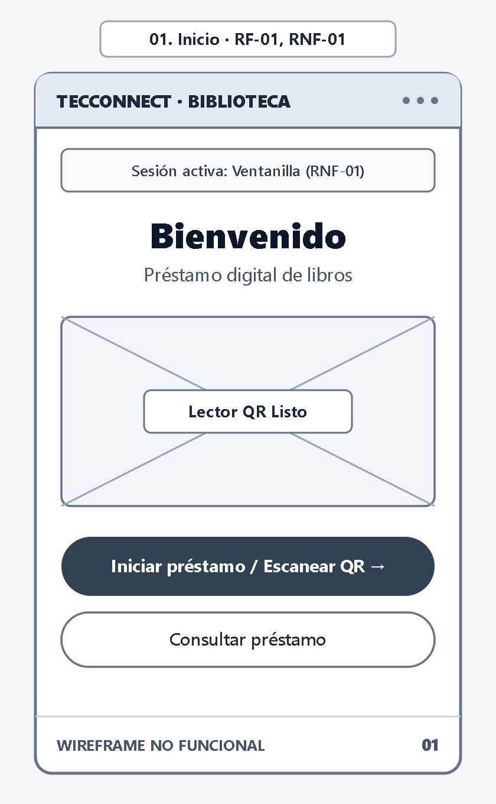
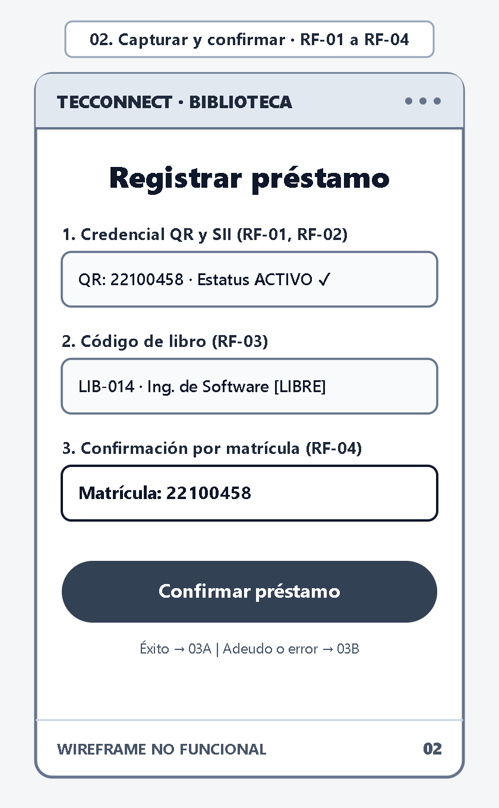
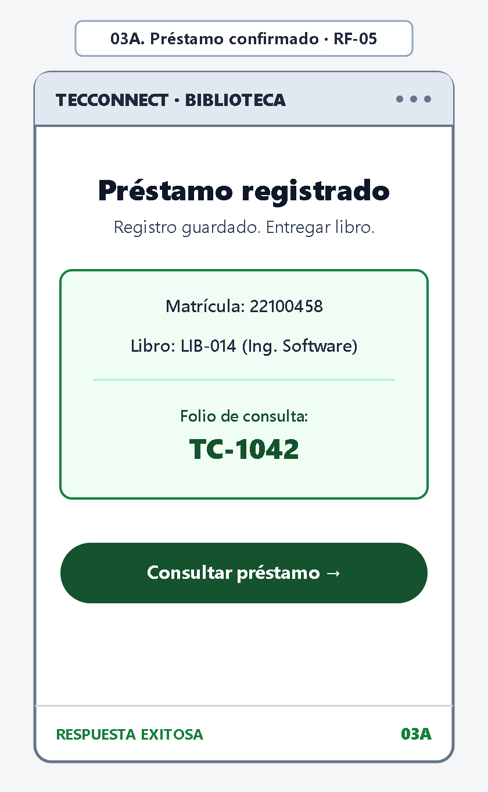
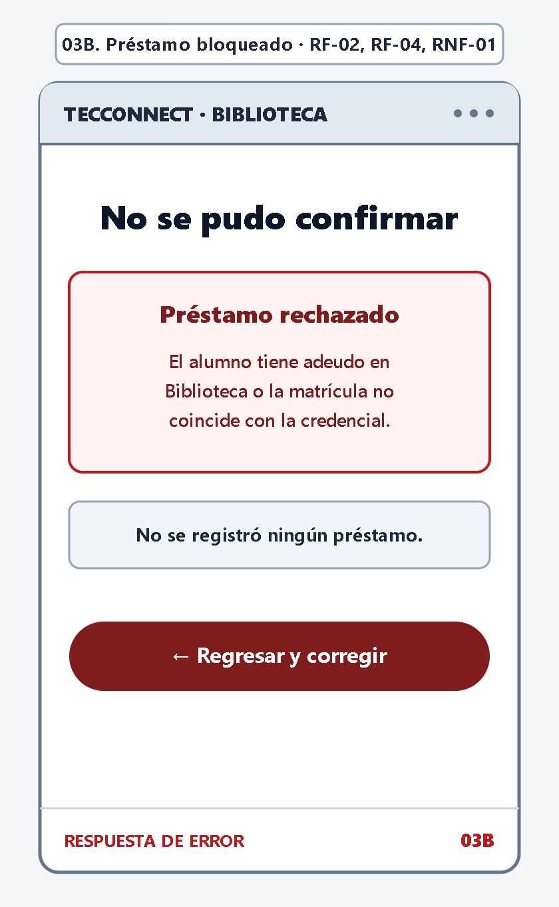
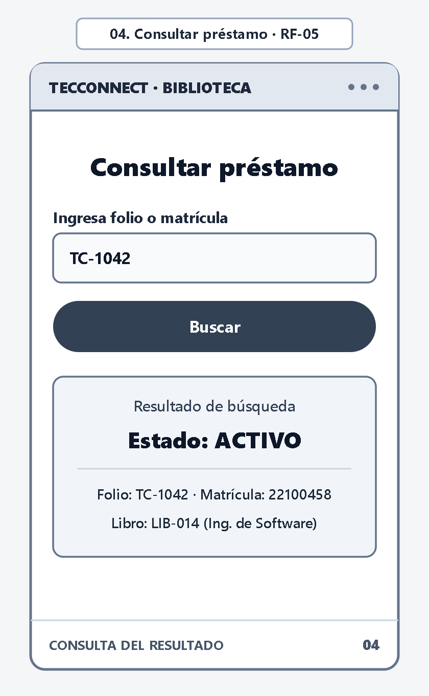

# U3-E01: Especificación de Requisitos y Prototipo — TecConnect

* **Institución:** Instituto Tecnológico Superior de San Pedro de las Colonias (ITSSPC)
* **Carrera:** Ingeniería en Sistemas Computacionales
* **Asignatura:** Fundamentos de Ingeniería de Software (SCC-1007) — Grupo 5° A
* **Docente:** Ruth Aivi Chávez Rodríguez
* **Proyecto:** TecConnect (Gestión Digital de Préstamos en Ventanilla de Biblioteca)
* **Repositorio:** `TecConect-Proyecto / fis-2026-e03-TecConect-main`

### Equipo y roles en Unidad 3
| Integrante | Rol principal en U3 | Requisitos asignados | Responsabilidad de revisión |
| :--- | :--- | :--- | :--- |
| **Jorge Luis Monsiváis Rodríguez** | Desarrollo y Coordinación | `RF-01`, `RF-02` | Elaboración de estructura base, entrevista F-03 y diseño de wireframes |
| **Alfonso Herrera Díaz** | Análisis | `RF-03`, `RF-04` | Levantamiento documental AS-IS, reglas del dominio y criterios F |
| **Ángel David Pérez Sánchez** | Calidad y Documentación (QA) | `RF-05`, `RNF-01` | Auditoría de calidad, trazabilidad, control de versiones e integración final |

---

## A. Identificación y alcance

* **Proceso TO-BE seleccionado:** Solicitud, validación y registro digital del préstamo de libros en ventanilla de Biblioteca mediante credencial digital QR y confirmación presencial por matrícula.
* **Objetivo de esta especificación:** Definir, estructurar y verificar los requisitos funcionales y no funcionales necesarios para automatizar en ventanilla la identificación del estudiante mediante QR, la validación automática de estatus académico y ausencia de adeudos en el SII, la comprobación de disponibilidad del libro, la autorización mediante matrícula y la generación de un registro digital con folio de consulta bajo un esquema de cero papel.

### Dentro del alcance
1. Escaneo y lectura del código QR de la credencial digital del estudiante en ventanilla (`RF-01`).
2. Consulta automática al Sistema Integral de Información (SII) y registros de Biblioteca para verificar estatus de alumno activo y ausencia de multas o libros pendientes (`RF-02`).
3. Escaneo del código de barras o identificador del ejemplar de libro solicitado y verificación de disponibilidad en inventario (`RF-03`).
4. Confirmación presencial de identidad y autorización del préstamo mediante captura de la matrícula del estudiante, con alertas claras ante bloqueo o discrepancia (`RF-04`).
5. Registro digital del préstamo autorizado (matrícula, código de libro, fecha y hora) con generación de folio único de consulta (`RF-05`).
6. Control de acceso autenticado para que únicamente personal autorizado de ventanilla consulte datos personales y académicos del SII (`RNF-01`).

### Fuera del alcance
* Cobranza o pago de multas y adeudos dentro de la aplicación (el sistema únicamente notifica el bloqueo y detiene el préstamo).
* Llenado de papeletas físicas, fichas de préstamo en cartulina o bitácoras manuales en papel.
* Catalogación de acervos nuevos, compra de ejemplares o restauración física de libros dañados.
* Préstamo de equipo de cómputo, proyectores o herramientas de laboratorio (gestionados por áreas distintas a Biblioteca).

---

## B. Fuentes y necesidades

### B1. Plan de obtención
| Pregunta por resolver | Persona o documento a consultar | Técnica | Responsable | Estado |
| :--- | :--- | :--- | :--- | :--- |
| ¿Qué fallas y tiempos muertos presenta el préstamo actual en papel? | Documentación base del proyecto (`trabajos.pdf`) | Análisis documental | Alfonso Herrera Díaz | Resuelta (`F-01`, `F-02`) |
| ¿Qué condiciones bloquean el préstamo de un libro en Biblioteca y qué datos se validan en el SII? | Encargada de Biblioteca (ITSSPC) | Entrevista semiestructurada | Jorge Luis Monsiváis Rodríguez | Resuelta (`F-03`) |
| ¿Qué método sencillo y seguro debe usar el estudiante en ventanilla para confirmar que autoriza el préstamo? | Encargada de Biblioteca (ITSSPC) | Entrevista semiestructurada | Jorge Luis Monsiváis Rodríguez | Resuelta (`F-03`: Matrícula) |
| ¿Cuál es el límite máximo de libros simultáneos y días de préstamo por tipo de material? | Reglamento interno de Biblioteca / TI | Revisión normativa | Ángel David Pérez Sánchez | Pendiente (ver `B4`) |

### B2. Fuentes realmente consultadas
| ID | Técnica o documento | Fecha | Hallazgo documentado | Estado |
| :--- | :--- | :--- | :--- | :--- |
| **F-01** | Revisión documental: acuerdo y descripción general de *TecConnect* | 08/10/2026 | El proyecto busca digitalizar los trámites estudiantiles en ventanilla mediante credencialización QR institucional y eliminar el uso de papel. | Documentado |
| **F-02** | Revisión documental: análisis del proceso actual AS-IS (`trabajos.pdf`) | 08/10/2026 | El préstamo actual de libros depende de captura manual en bitácora, revisión lenta de credenciales y falta de consulta rápida de folios activos. | Documentado |
| **F-03** | Entrevista semiestructurada: Encargada de Biblioteca (ITSSPC) | 10/11/2026 | Se confirmó que solo alumnos activos en el SII pueden solicitar libros; el sistema debe bloquear el préstamo si el alumno tiene multas o libros vencidos pendientes, y el estudiante debe confirmar su préstamo ingresando su **matrícula**. | Validado (Acta 01) |

### B3. Necesidades identificadas
| ID | Necesidad | Fuente | Descripción | Prioridad |
| :--- | :--- | :--- | :--- | :--- |
| **N-01** | Identificación ágil del estudiante en ventanilla | `F-01`, `F-02`, `F-03` | Sustituir la transcripción manual de datos de credencial por la lectura inmediata del código QR del alumno. | Alta |
| **N-02** | Validación automática de vigencia y adeudos | `F-03` | Verificar en tiempo real en el SII si el estudiante está activo y libre de multas o libros pendientes antes de prestar un ejemplar. | Alta |
| **N-03** | Verificación rápida del libro solicitado | `F-02`, `F-03` | Identificar el código del libro en ventanilla y comprobar que su estado en inventario sea disponible. | Alta |
| **N-04** | Confirmación presencial y retroalimentación clara | `F-03` | Exigir la matrícula del estudiante para autorizar el registro y mostrar mensajes de texto explícitos cuando el préstamo sea rechazado. | Alta |
| **N-05** | Trazabilidad digital y privacidad de datos | `F-01`, `F-02`, `F-03` | Guardar cada préstamo con folio consultable y restringir el acceso a datos del SII únicamente al personal de ventanilla. | Alta |

### B4. Datos pendientes por validar (Separación explícita)
Para evitar inventar reglas operativas sin respaldo documental, los siguientes parámetros quedan marcados como **Por validar** con la administración de Biblioteca y TI institucional:
1. **Cantidad máxima de ejemplares simultáneos:** Número máximo de libros que un alumno activo puede tener prestados al mismo tiempo.
2. **Plazo de devolución por colección:** Días hábiles permitidos según se trate de acervo general, consulta interna o bibliografía básica.
3. **Contingencia por etiqueta dañada:** Procedimiento alternativo en pantalla cuando el código de barras del libro esté ilegible.

---

## C. Organización del alcance

* **Ruta elegida:** Ruta A (con Épica).
* **Motivo:** El proceso seleccionado integra múltiples capacidades operativas secuenciales (lectura QR de identidad, validación de estatus y adeudos en el SII, verificación de disponibilidad del libro, autorización por matrícula y emisión de folio consultable).
* **Épica:** `EP-01: Gestión Digital de Préstamos de Libros en Ventanilla de Biblioteca`
* **Capacidades incluidas:**
  1. Autenticación de ventanilla y lectura de credencial digital QR (`RF-01`, `RNF-01`).
  2. Validación automática de estatus académico y bloqueo por adeudos (`RF-02`).
  3. Identificación y comprobación de disponibilidad del libro (`RF-03`).
  4. Confirmación presencial por matrícula y notificación textual de errores (`RF-04`).
  5. Registro digital del préstamo y consulta posterior por folio (`RF-05`).
* **RF y RNF vinculados:** `RF-01`, `RF-02`, `RF-03`, `RF-04`, `RF-05` y `RNF-01`.

---

## D. Reglas del dominio institucionales

| ID | Regla del dominio | Origen | Impacto en el sistema |
| :--- | :--- | :--- | :--- |
| **RG-01** | **Vigencia académica obligatoria:** Únicamente los estudiantes con estatus inscrito/activo en el SII tienen derecho al préstamo de libros en Biblioteca. | `F-03` | Impide iniciar o confirmar préstamos a matrículas dadas de baja o inactivas. |
| **RG-02** | **Bloqueo por adeudos o material pendiente:** Ningún estudiante con multas vigentes o libros vencidos sin devolver en Biblioteca puede recibir un nuevo ejemplar. | `F-03` | Obliga a rechazar automáticamente la operación y mostrar el motivo explícito en pantalla. |
| **RG-03** | **Autorización personal mediante matrícula:** Todo préstamo en ventanilla requiere que el estudiante confirme presencialmente ingresando su propia matrícula coincidente con la credencial QR leída. | `F-03` | Evita préstamos suplantados o registrados sin consentimiento del titular. |

---

## E. Catálogo estructurado de requisitos

| ID | Tipo | Enunciado verificable | Origen (`B2`/`B3`) | Prioridad y motivo | Autor | Estado |
| :--- | :--- | :--- | :--- | :--- | :--- | :--- |
| **RF-01** | RF | El sistema debe leer el código QR de la credencial digital del estudiante y recuperar su matrícula y nombre en la pantalla de captura de ventanilla. | `F-01`, `F-03` / `N-01` | **P1 (Alta):** Es el punto de entrada indispensable para identificar al solicitante sin captura manual. | Jorge Luis Monsiváis Rodríguez | Validado |
| **RF-02** | RF | El sistema debe consultar el estatus del estudiante en el SII y bloquear el préstamo cuando detecte inactividad académica, multas vigentes o libros pendientes de devolución. | `F-03` / `N-02` | **P1 (Alta):** Garantiza el cumplimiento directo de las reglas institucionales `RG-01` y `RG-02`. | Jorge Luis Monsiváis Rodríguez | Validado |
| **RF-03** | RF | El sistema debe leer el código identificador del libro solicitado y verificar en tiempo real que su estado en el inventario de Biblioteca sea disponible. | `F-02`, `F-03` / `N-03` | **P1 (Alta):** Evita asignar ejemplares ya prestados o reservados en sala. | Alfonso Herrera Díaz | Validado |
| **RF-04** | RF | El sistema debe solicitar la matrícula del estudiante para confirmar el préstamo y desplegar un mensaje de error textual claro con opción de retorno cuando la matrícula no coincida o exista bloqueo. | `F-03` / `N-04` | **P1 (Alta):** Asegura la autorización presencial (`RG-03`) y evita errores silenciosos en ventanilla. | Alfonso Herrera Díaz | Validado |
| **RF-05** | RF | El sistema debe guardar el registro digital del préstamo autorizado (matrícula, código de libro, fecha y hora), generar un folio único de consulta (`TC-XXXX`) y permitir consultar su estado activo posteriormente. | `F-01`, `F-02`, `F-03` / `N-05` | **P1 (Alta):** Sustituye la bitácora en papel y permite dar seguimiento comprobable a cada ejemplar entregado. | Ángel David Pérez Sánchez | Validado |
| **RNF-01** | RNF | El sistema debe restringir la consulta de datos personales y estatus del SII únicamente al personal de ventanilla previamente autenticado, y expresar todo aviso de error mediante texto explícito (sin depender solo de color). | `F-03` / `N-05` | **P2 (Media-Alta):** Protege la privacidad de los datos estudiantiles y asegura comprensibilidad operativa en ventanilla. | Ángel David Pérez Sánchez | Por validar (TI) |

---

## F. Criterios de aceptación verificables

| ID Req. | Escenario | Condición (Dado) | Acción (Cuando) | Resultado observable esperado (Entonces) |
| :--- | :--- | :--- | :--- | :--- |
| **RF-01** | Éxito (QR válido) | El operador de ventanilla inicia un nuevo préstamo en el estado `01`. | Escanea el código QR vigente de la credencial digital del alumno en el estado `02`. | El sistema muestra en menos de 2 segundos la matrícula (`22100458`) y el nombre del estudiante en pantalla. |
| **RF-01** | Error (QR ilegible) | El operador intenta escanear una credencial digital en el estado `02`. | El código QR está dañado, borroso o no corresponde al formato institucional. | El sistema muestra el aviso textual *"Código QR no reconocido; intente nuevamente"* y no avanza a confirmación. |
| **RF-02** | Éxito (Alumno elegible) | Se identificó la matrícula de un estudiante inscrito activo sin adeudos en Biblioteca. | El sistema consulta automáticamente el SII y el historial de Biblioteca. | Muestra el indicador *"Estatus ACTIVO · Sin adeudos"* y habilita la continuación del trámite. |
| **RF-02** | Error (Adeudo o baja) | Se lee la credencial de un estudiante con multa vigente, libro vencido o baja académica. | El sistema ejecuta la validación previa a la confirmación. | Bloquea el registro, transita al estado `03B` y muestra el texto *"Préstamo rechazado: el alumno tiene adeudo en Biblioteca"*. |
| **RF-03** | Éxito (Libro disponible) | El estudiante ya fue validado como elegible en el estado `02`. | El operador escanea el código del ejemplar `LIB-014`. | El sistema muestra el título/código del libro y confirma su estado como `DISPONIBLE`. |
| **RF-03** | Error (Libro ocupado) | El operador escanea un ejemplar cuyo registro aparece actualmente como prestado. | El sistema consulta el inventario de Biblioteca. | Muestra el aviso *"El libro seleccionado no está disponible"* e impide confirmar el préstamo. |
| **RF-04** | Éxito (Matrícula correcta) | Todos los datos de alumno y libro son válidos en el estado `02`. | El estudiante ingresa su matrícula (`22100458`) coincidente con el QR y se pulsa *Confirmar préstamo*. | El sistema autoriza la operación y avanza al estado de éxito `03A`. |
| **RF-04** | Error (Matrícula errónea) | El estudiante captura una matrícula que no coincide con la credencial escaneada. | Se presiona *Confirmar préstamo*. | El sistema rechaza la operación, muestra la vista `03B` con el texto explicativo del error y habilita el botón *Regresar y corregir* hacia `02`. |
| **RF-05** | Éxito (Registro y consulta) | El préstamo fue autorizado en el estado `03A`. | Se guarda la transacción y posteriormente se busca el folio `TC-1042` en la vista `04`. | El sistema genera el folio `TC-1042`, almacena matrícula, libro y marca de tiempo, y despliega `Estado: ACTIVO` en la consulta. |
| **RNF-01** | Acceso y legibilidad textual | Un usuario sin sesión autenticada de ventanilla intenta consultar datos del SII, o ocurre un rechazo en `03B`. | Se realiza el intento de acceso o se dispara una validación fallida. | El acceso sin credenciales de ventanilla es denegado, y todo rechazo en `03B` incluye explicación textual clara además del indicador visual. |

---

## G. Priorización, Backlog y Prototipo de Baja Fidelidad

### G1. Backlog priorizado y trazabilidad en Trello (`TecConect 2.0`)
| Orden | ID | Título resumido | Prioridad | Dependencia real | Tarjeta Trello asociada | Responsable |
| :--- | :--- | :--- | :--- | :--- | :--- | :--- |
| 1 | **RF-01** | Lectura de credencial QR y recuperación de alumno | `P1` | Ninguna (Punto de entrada) | `[TC-05]` Aporte y criterio RF-01 | Jorge Luis Monsiváis Rodríguez |
| 2 | **RF-02** | Validación de estatus SII y bloqueo por adeudos | `P1` | Depende de `RF-01` | `[TC-06]` Aporte y criterio RF-02 | Jorge Luis Monsiváis Rodríguez |
| 3 | **RF-03** | Escaneo de código de libro y disponibilidad | `P1` | Depende de `RF-01` | `[TC-07]` Aporte y criterio RF-03 | Alfonso Herrera Díaz |
| 4 | **RF-04** | Confirmación por matrícula y alertas textuales | `P1` | Depende de `RF-01`, `RF-02`, `RF-03` | `[TC-08]` Aporte y criterio RF-04 | Alfonso Herrera Díaz |
| 5 | **RF-05** | Registro digital de préstamo y consulta por folio | `P1` | Depende de `RF-04` | `[TC-09]` Aporte y criterio RF-05 | Ángel David Pérez Sánchez |
| 6 | **RNF-01** | Restricción de acceso SII y claridad textual de errores | `P2` | Transversal (`RF-01` a `RF-04`) | `[TC-10]` Aporte y criterio RNF-01 | Ángel David Pérez Sánchez |

### G2. Secuencia de wireframes de baja fidelidad (Recorrido principal)
* **Alcance metodológico (IREB CPRE / Yale Usability):** Este apartado presenta una **secuencia de wireframes estáticos de baja fidelidad** (prototipo exploratorio estático) diseñada para validar la estructura de pantallas, el flujo de decisiones y los requisitos antes de programar. No constituye una aplicación funcional ni está conectada a una base de datos real.
* **Estructura del recorrido:** Cumple con los **cuatro momentos** solicitados en la Unidad 3 (*Inicio*, *Acción*, *Respuesta* y *Consulta*) representados mediante **cinco estados visibles** (`01`, `02`, `03A`, `03B` y `04`), donde el bloque de respuesta se desdobla en éxito (`03A`) y error (`03B`).

#### 1. Estado `01` — Inicio (`RF-01`, `RNF-01`)
* **Qué representa:** Punto de entrada autenticado para el personal de ventanilla de Biblioteca (`RNF-01`), con el lector QR listo y una acción principal visible para iniciar el trámite (`RF-01`).
* **Transición (flecha de flujo):** Al presionar **Iniciar préstamo / Escanear QR** avanza directamente al estado **02** (o al presionar *Consultar préstamo* permite ir a **04**).

---

#### 2. Estado `02` — Capturar y confirmar (`RF-01`, `RF-02`, `RF-03`, `RF-04`)
* **Qué representa:** Vista operativa donde se concentra la captura y validación del préstamo:
  1. Lectura de credencial QR y verificación de estatus activo sin adeudos en el SII (`RF-01`, `RF-02`).
  2. Lectura del código del libro solicitado (`LIB-014`) y confirmación de disponibilidad (`RF-03`).
  3. Campo para que el estudiante ingrese presencialmente su **matrícula** (`22100458`) y autorice la operación (`RF-04`).
* **Transición (bifurcación de flujo):** Al pulsar **Confirmar préstamo**, si todas las validaciones se cumplen avanza a **03A (Éxito)**; si existe adeudo en Biblioteca, libro ocupado o error de matrícula, bifurca hacia **03B (Error)**.

---

#### 3. Estado `03A` — Préstamo confirmado / Respuesta exitosa (`RF-05`)
* **Qué representa:** Confirmación inmediata del registro guardado en el sistema, mostrando la matrícula, el código del libro (`LIB-014`) y el **folio de consulta `TC-1042`** (`RF-05`) para autorizar la entrega física del ejemplar.
* **Transición (flecha de flujo):** Únicamente desde este estado **03A** se continúa hacia el estado **04** al presionar **Consultar préstamo**.

---

#### 4. Estado `03B` — Préstamo bloqueado / Respuesta de error (`RF-02`, `RF-04`, `RNF-01`)
* **Qué representa:** Respuesta inmediata ante rechazo operativo. Cumple la regla de usabilidad de no depender únicamente de un color o ícono: explica mediante **texto explícito** el motivo del bloqueo (*"El alumno tiene adeudo en Biblioteca o la matrícula no coincide"*) y aclara que **no se registró ningún préstamo** (`RF-02`, `RF-04`, `RNF-01`).
* **Transición (flecha de retorno):** Al presionar **Regresar y corregir** vuelve obligatoriamente al estado **02** para revisar o corregir los datos capturados (no permite avanzar a `04`).

---

#### 5. Estado `04` — Consultar préstamo / Consulta del resultado (`RF-05`)
* **Qué representa:** Cierre del recorrido permitiendo verificar posteriormente el préstamo registrado. Responde las tres preguntas de comprobación del flujo:
  1. **¿Cómo recupera la información?** Accediendo a la vista de consulta `04` desde `03A` o desde el inicio `01`.
  2. **¿Qué dato utiliza para buscarla?** El folio único generado en el comprobante (`TC-1042`).
  3. **¿Qué resultado observable aparece?** El bloque *Resultado de búsqueda* con `Estado: ACTIVO`, `Folio: TC-1042`, `Matrícula: 22100458` y `Libro: LIB-014` (`RF-05`).

---

### G3. Comprobación visual de vistas y requisitos
| Vista / Estado | Requisitos vinculados | ¿Qué permite revisar visualmente en el wireframe? |
| :--- | :--- | :--- |
| **01. Inicio** | `RF-01`, `RNF-01` | Sesión autenticada de ventanilla y botón principal visible para iniciar el escaneo QR. |
| **02. Capturar y confirmar** | `RF-01`, `RF-02`, `RF-03`, `RF-04` | Campos secuenciales de QR/SII, código de libro disponible, captura de matrícula y botón de confirmación. |
| **03A. Préstamo confirmado** | `RF-05` | Mensaje de registro exitoso, generación del folio `TC-1042` y enlace hacia consulta. |
| **03B. Préstamo bloqueado** | `RF-02`, `RF-04`, `RNF-01` | Explicación textual clara del rechazo, confirmación de no registro y botón de retorno a `02`. |
| **04. Consultar préstamo** | `RF-05` | Campo de búsqueda por folio (`TC-1042`) y tarjeta de resultado mostrando el estado `ACTIVO` del libro. |

---

## H. Matriz de trazabilidad y control de cambios

### H1. Matriz de trazabilidad completa
| ID | Tipo | Fuente (`B2`) | Necesidad (`B3`) | Criterio de aceptación (`F`) | Vista Wireframe (`G`) | Autor |
| :--- | :--- | :--- | :--- | :--- | :--- | :--- |
| **RF-01** | Funcional | `F-01`, `F-03` | `N-01` | `RF-01` (Éxito QR válido / Error QR ilegible) | `01`, `02` | Jorge Luis Monsiváis Rodríguez |
| **RF-02** | Funcional | `F-03` | `N-02` | `RF-02` (Éxito alumno elegible / Error adeudo o baja) | `02`, `03B` | Jorge Luis Monsiváis Rodríguez |
| **RF-03** | Funcional | `F-02`, `F-03` | `N-03` | `RF-03` (Éxito libro disponible / Error libro ocupado) | `02` | Alfonso Herrera Díaz |
| **RF-04** | Funcional | `F-03` | `N-04` | `RF-04` (Éxito matrícula correcta / Error matrícula errónea) | `02`, `03B` | Alfonso Herrera Díaz |
| **RF-05** | Funcional | `F-01`, `F-02`, `F-03` | `N-05` | `RF-05` (Éxito registro de folio `TC-1042` y consulta) | `03A`, `04` | Ángel David Pérez Sánchez |
| **RNF-01** | No Funcional | `F-03` | `N-05` | `RNF-01` (Restricción de acceso SII y texto explícito en error) | `01`, `03B` | Ángel David Pérez Sánchez |

### H2. Control de cambios de la especificación
| Versión | Fecha | Cambio realizado | Justificación / Fuente | Responsable |
| :--- | :--- | :--- | :--- | :--- |
| `v1.0` | 12/11/2026 | Borrador inicial de apartados A, B1 y C en repositorio (`main`). | Estructura base de arranque de la Unidad 3. | Jorge Luis Monsiváis Rodríguez |
| `v1.1` | 15/11/2026 | Sustitución del método de confirmación por NIP hacia **matrícula del estudiante**. | Hallazgo validado en entrevista con Encargada de Biblioteca (`F-03`). | Alfonso Herrera Díaz / Jorge L. Monsiváis |
| `v2.0` | 17/11/2026 | Alineación integral del alcance a **préstamo de libros en Biblioteca**, estandarización de `RF-01` a `RF-05` + `RNF-01`, incorporación de los 5 wireframes secuenciados y matriz H completa. | Auditoría de Calidad (QA) para garantizar coherencia entre fuentes (`F-03`), criterios `F` y recorrido `G`. | Ángel David Pérez Sánchez (QA) |

---

## I. Referencias y herramientas utilizadas

### Fuentes del dominio y documentación institucional
1. **Entrevista semiestructurada en Biblioteca ITSSPC (`F-03`):** Encargada del área de Biblioteca del Instituto Tecnológico Superior de San Pedro de las Colonias (10 de noviembre de 2026). Validación de reglas de vigencia en SII, bloqueo por adeudos/libros pendientes y confirmación mediante matrícula.
2. **Documentación base del proyecto (`F-01`, `F-02`):** Acuerdo inicial de proyecto *TecConnect* y análisis de proceso actual AS-IS (`trabajos.pdf`, Unidad 2, octubre de 2026).

### Herramientas de soporte en Unidad 3
* **GitHub:** Control de versiones, ramas de trabajo, revisión entre pares y almacenamiento de documentación en Markdown (`docs/U3/` y `bitacoras/U3/`).
* **Trello (`TecConect 2.0`):** Tablero Kanban de seguimiento de tareas, responsables y revisión de calidad.
* **Generación de wireframes digitales:** Secuencia de 5 vistas de baja fidelidad exportadas en formato PNG (`docs/U3/prototipo/`).
